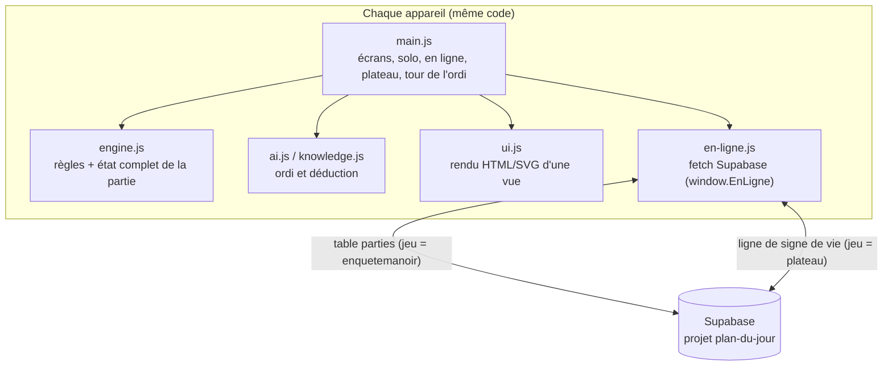
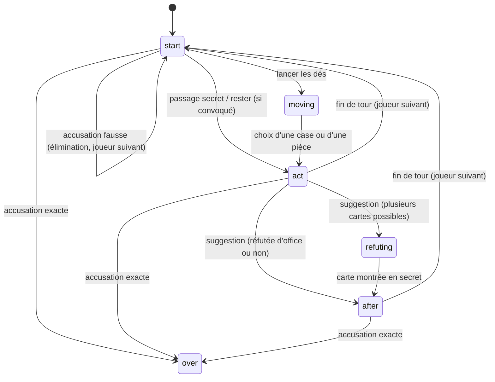

# Architecture d'EnqueteManoir

Application web statique (HTML + CSS + JavaScript en modules ES, sans étape de compilation), publiée par GitHub Pages et installable comme PWA. Deux façons de jouer : **solo** (1 humain contre des ordinateurs, tout en local) et **En ligne** (2 humains, un appareil chacun, via Supabase), avec un **plateau** optionnel (iPad en affichage commun, lecture seule).

## Vue d'ensemble

## Principe clé : l'état complet est dans la ligne, l'écran filtre « par confiance »

- Une partie en ligne = **une ligne** de la table `parties` : `{ id (code 4 lettres), jeu: 'enquetemanoir', titre, etat (jsonb), version, maj }`. L'`etat` est l'état complet d'`engine.js` (dossier confidentiel et mains compris) plus `online: { uids: [hôte, invité], joined, seats: [pidHôte, pidInvité] }`.
- Chaque écran affiche seulement **sa vue** : `vuePour(état, pid)` (plateau public, historique public des suggestions, **sa** main, **ses** cartes vues). Le plateau commun utilise `vuePour(état, null)` : aucune main, aucune carte montrée, pas de solution avant la fin. Ce filtrage est à l'écran, pas dans la base : un joueur qui lirait la ligne à la main pourrait tricher (choix assumé : confiance entre amis).
- **Écriture optimiste** : on écrit seulement si la version n'a pas bougé (`PATCH ?version=eq.N`). En cas de conflit, l'état distant l'emporte et le message « Ton action a été annulée » s'affiche. Sondage de la version toutes les 1,5 s.
- Les **ordinateurs** sont joués par l'**hôte** seul (siège 0), après le départ de l'invité ; l'ordi ne lit que la vue de son joueur. Si l'hôte ferme l'application, les ordinateurs s'arrêtent (les humains peuvent encore jouer leur tour mais le tour d'un ordi reste en attente).
- `render()` n'écrit **jamais** dans la partie (sinon écritures en rafale).

## Plateau commun (iPad)

- Écran « Plateau » : lecture seule, personne ne joue dessus. Il lit la ligne de la partie (sondage) et affiche plateau, pions, armes, joueurs, **suggestions publiques**, journal public. Aucune main, aucun bouton d'action.
- Il n'écrit **jamais** dans la ligne de la partie. Il écrit un **signe de vie** dans sa propre ligne (`jeu='plateau'`, `titre` = code de la partie), battement 1,5 s puis 10 s.
- Chaque téléphone surveille cette ligne (toutes les 5 s) : si sa version change (< 30 s), il **masque la table commune** (plateau de jeu, joueurs) et garde main, carnet et boutons. Pour choisir sa case, le mini-plateau réapparaît le temps du déplacement. Bouton manuel « Afficher la table » / « Masquer la table ».
- Au premier passage on note seulement la version : une ligne laissée par une ancienne séance ne compte pas comme un plateau présent.
- Hypothèse non vérifiée avec le vrai serveur : la table accepte `jeu='plateau'` (sinon les téléphones gardent simplement la table affichée, sans erreur).

## Machine à états d'un tour

## Fichiers

| Fichier | Rôle |
|---|---|
| `js/data.js` | Personnages, armes, pièces, grille 24×25, portes, passages secrets, cartes. |
| `js/engine.js` | `nouvellePartie`, `appliquer(état, action)`, `calculerPortee`, `vuePour`. Aucune dépendance au navigateur : testable avec Node. |
| `js/knowledge.js` | `deduire(vue, niveau)` : qui peut détenir chaque carte (propagation de contraintes). Sert à l'ordi et à l'aide du carnet. |
| `js/ai.js` | `decider(vue)` : un coup de l'ordi selon le niveau (1 Débutant, 2 Moyen, 3 Expert). |
| `js/ui.js` | Génère le HTML/SVG à partir d'une vue (plateau, panneau du joueur, carnet, fenêtres). |
| `en-ligne.js` | Brique commune à tous les jeux (copie identique) : compte Supabase, `creer`, `lire`, `ecrire` (optimiste), `liste`, `supprimer`, `surveiller`. Script classique, expose `window.EnLigne`. |
| `js/main.js` | Écrans, solo, en ligne (création, rejoindre, reprise, conflits), plateau et sa détection, tours de l'ordi. |
| `sw.js`, `manifest.webmanifest`, `icons/` | PWA : fonctionnement hors ligne et installation. |
| `tests/*.test.mjs` | Tests Node (`npm test`) : moteur, vues publiques sans fuite. |
| `tests/e2e/en_ligne.py` | Test navigateur (Playwright) avec faux Supabase en mémoire : 2 appareils + plateau + solo. |

## Niveaux de l'ordi

| Niveau | Déduction | Choix |
|---|---|---|
| 1 Débutant | Sa main et les cartes qu'on lui montre | Aléatoire |
| 2 Moyen | + cartes que les autres n'ont pas pu montrer, règle du dossier | Suggestions parmi les cartes encore possibles |
| 3 Expert | + tailles de mains, clauses de réfutation (« l'un des trois est chez X ») | Cartes presque résolues en priorité, pièces au plus près de la solution |

## Mode En ligne : déroulé

1. L'hôte se connecte (compte commun aux jeux), choisit les places : **Moi**, **Invité** (exactement un chacun), **Ordi** (3 niveaux) ou **Absent** ; la partie est créée, un **code à 4 lettres** s'affiche.
2. L'invité se connecte, saisit le code (et éventuellement son prénom) : il prend la place « Invité », la partie démarre.
3. Chacun joue sur son appareil ; le coup est appliqué localement par le moteur puis écrit. L'autre appareil le voit au sondage suivant.
4. « Reprendre » : un appareil retrouve sa place par la liste de ses parties (ou par l'identifiant du compte). « Rejouer » à la fin : même code, nouveau dossier.
5. Supprimer la partie la retire de la base ; l'autre appareil est renvoyé au menu avec un message.

## Données stockées sur l'appareil

`localStorage` : partie solo en cours, marques du carnet par partie et par joueur, réglage de l'aide, prénom, correspondance code → place pour les parties en ligne, session du compte (partagée avec les autres jeux). La partie solo n'écrit rien sur le serveur.

## Limites connues

- Plateau recréé à la main : proche du plateau classique, mais pas identique case par case.
- Mode En ligne testé avec un faux Supabase (Chromium) : pas encore sur de vrais iPad / iPhone ni sur le vrai serveur.
- 2 humains maximum en ligne ; les ordinateurs ne jouent que si l'application de l'hôte est ouverte.
- Information cachée « par confiance » : l'état complet est lisible dans la base par un compte connecté.
