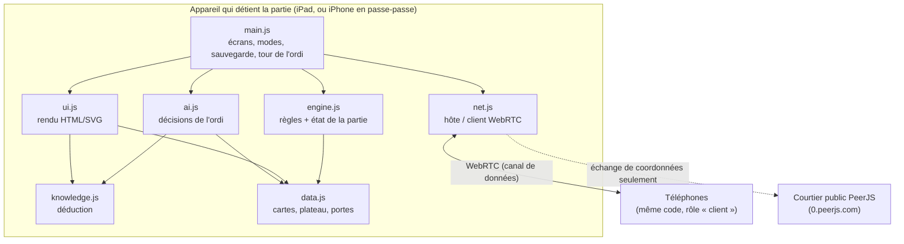
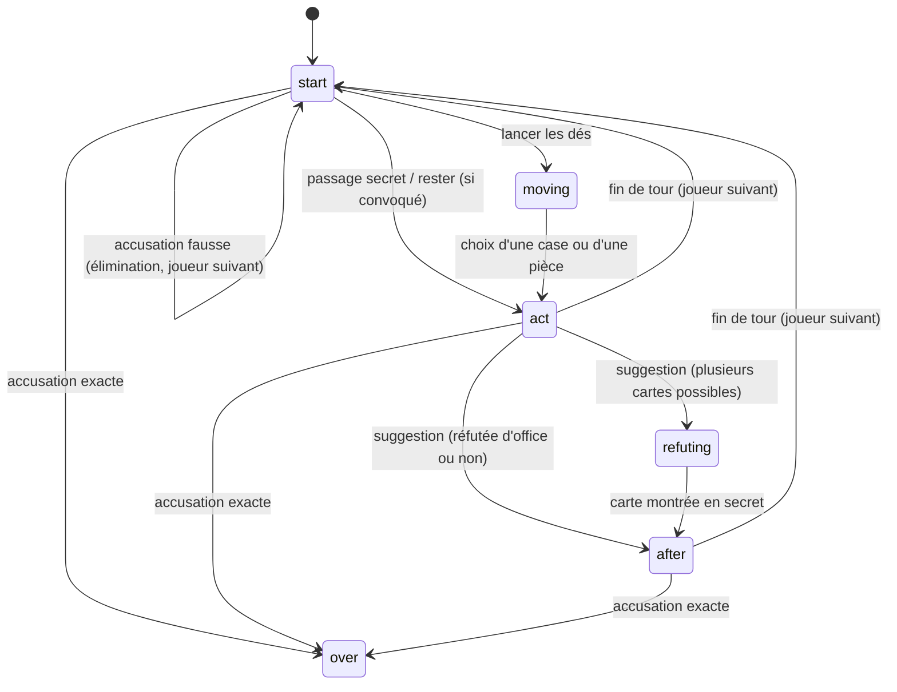

# Architecture d'EnqueteManoir

Application web statique (HTML + CSS + JavaScript en modules ES, sans étape de compilation), publiée par GitHub Pages et installable comme PWA.

## Vue d'ensemble

## Principe clé : la partie n'existe qu'à un endroit

- L'**état complet** (dossier confidentiel, mains de tous) n'est détenu que par l'appareil hôte (`engine.js`).
- Chaque joueur reçoit une **vue** produite par `vuePour(état, joueur)` : plateau public, historique public des suggestions, **sa** main, **ses** cartes vues. Jamais le dossier, jamais les mains des autres.
- L'**ordinateur** ne lit que la vue de son joueur (aucune triche possible).
- Sur un téléphone, l'hôte **impose l'identité** de l'expéditeur de chaque action (un téléphone ne peut pas jouer à la place d'un autre).

## Machine à états d'un tour

## Fichiers

| Fichier | Rôle |
|---|---|
| `js/data.js` | Personnages, armes, pièces, grille 24×25, portes, passages secrets, cartes. |
| `js/engine.js` | `nouvellePartie`, `appliquer(état, action)`, `calculerPortee`, `vuePour`. Aucune dépendance au navigateur : testable avec Node. |
| `js/knowledge.js` | `deduire(vue, niveau)` : qui peut détenir chaque carte (propagation de contraintes). Sert à l'ordi et à l'aide du carnet. |
| `js/ai.js` | `decider(vue)` : un coup de l'ordi selon le niveau (1 Débutant, 2 Moyen, 3 Expert). |
| `js/ui.js` | Génère le HTML/SVG à partir d'une vue (plateau, panneau du joueur, carnet, fenêtres). |
| `js/net.js` | `SalonHote` / `ClientTel` : salon, places, vues par téléphone, secours manuel. |
| `js/main.js` | Écrans, modes (passe-passe, face à face, hôte, client), sauvegarde locale, tours de l'ordi. |
| `sw.js`, `manifest.webmanifest`, `icons/` | PWA : fonctionnement hors ligne et installation. |
| `js/vendor/` | PeerJS et qrcode-generator (licence MIT), copiés dans le dépôt pour ne dépendre d'aucun CDN. |
| `tests/` | Tests Node (`npm test`). |

## Niveaux de l'ordi

| Niveau | Déduction | Choix |
|---|---|---|
| 1 Débutant | Sa main et les cartes qu'on lui montre | Aléatoire |
| 2 Moyen | + cartes que les autres n'ont pas pu montrer, règle du dossier | Suggestions parmi les cartes encore possibles |
| 3 Expert | + tailles de mains, clauses de réfutation (« l'un des trois est chez X ») | Cartes presque résolues en priorité, pièces au plus près de la solution |

## Mode téléphones

1. L'iPad (hôte) ouvre un salon : code à 4 chiffres, enregistré auprès du courtier PeerJS sous `enquetemanoir-<code>`.
2. Chaque téléphone se connecte avec ce code : une liaison **directe** WebRTC s'établit. Le courtier ne voit que l'échange de coordonnées, jamais la partie.
3. Chaque téléphone choisit sa place ; quand tout est pris, l'hôte lance la partie et envoie à chacun sa vue après chaque action.
4. **Secours sans courtier** : l'iPad crée une invitation (texte), le téléphone répond par un texte ; les deux sont copiés à la main (message, AirDrop…).
5. Reconnexion : un téléphone déconnecté retrouve sa place ; le jeu attend son retour s'il devait jouer.

## Données stockées sur l'appareil

`localStorage` : partie en cours (passe-passe / face à face), marques du carnet par partie et par joueur, réglage de l'aide automatique. Aucune donnée n'est envoyée à un serveur.

## Limites connues

- Plateau recréé à la main : proche du plateau classique, mais pas identique case par case.
- Mode téléphones : le code à 4 chiffres dépend du courtier public PeerJS ; testé ici par la connexion manuelle (WebRTC réel entre deux pages) et par des tests de protocole, mais pas encore sur de vrais iPad/iPhone en wifi.
- Face à face : 2 humains maximum (au-delà, utiliser passe-passe ou téléphones).
